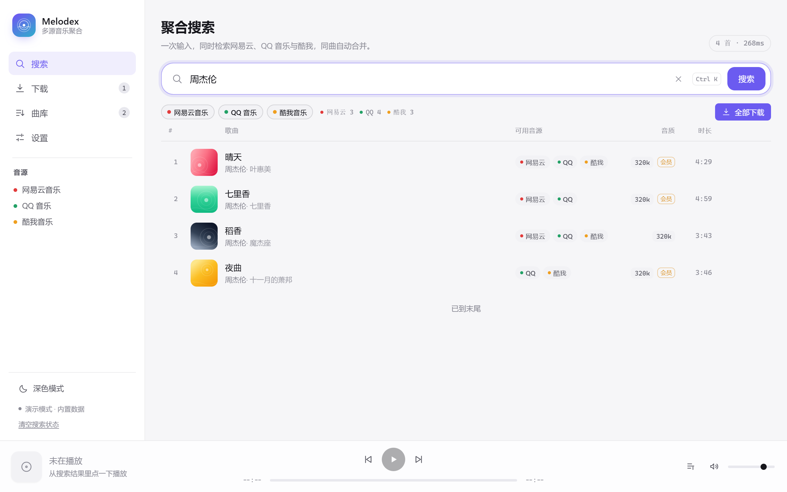

# Melodex Music

**English** · [简体中文](README.md)

**Multi-source music aggregation · built-in player with line-by-line lyrics · batch downloads — Windows / macOS / Linux desktop + Android**

Type one keyword and Melodex searches NetEase Cloud Music, QQ Music, Kuwo and Kugou at the same time,
then merges the same song into a single row: play it in place, follow the lyrics line by line,
and download in batch with ID3 tags and cover art written on the way out.
The desktop build runs a Rust download engine; the phone build shares the same core and the same UI.

<sub>The app is called **Melodex Music**; the repository is `Melodex-Music` because GitHub repo names cannot contain spaces.
On screen, "MUSIC" sits in its own small badge so the name reads as Melodex · Music.</sub>

<sub>Keywords: multi-source music search · online music player · synced lyrics · music downloader · NetEase Cloud Music ·
QQ Music · Kuwo · Kugou · account playlists · batch download · resumable transfer · 320 kbps and lossless · ID3 tags ·
embedded lyrics · in-app update · Tauri app · Windows desktop · Android app</sub>

[](LICENSE)
[](#platform-support)
[](crates/melodex-core)
[](src)



---

## Contents

- [What it solves](#what-it-solves)
- [Features](#features)
- [Interface](#interface)
- [Accounts and local encryption](#accounts-and-local-encryption)
- [In-app updates](#in-app-updates)
- [Architecture](#architecture)
- [Notable implementation details](#notable-implementation-details)
- [Source support](#source-support)
- [More platforms](#more-platforms)
- [Platform support](#platform-support)
- [Quick start](#quick-start)
- [Build a Windows installer](#build-a-windows-installer)
- [Build macOS / Linux packages](#build-macos--linux-packages)
- [Build the Android APK](#build-the-android-apk)
- [Publish installers (GitHub Release)](#publish-installers-github-release)
- [Development and debugging](#development-and-debugging)
- [Project layout](#project-layout)
- [FAQ](#faq)
- [Known limits and roadmap](#known-limits-and-roadmap)
- [Disclaimer](#disclaimer)
- [License](#license)

---

## What it solves

Downloading one old song usually means trying three apps in turn: this one lost the rights, that one only has 128 kbps,
the third hands you a preview clip instead of the track. **Melodex collapses that into one action:**

| The usual way | Melodex Music |
| --- | --- |
| Search app by app, guess whether it is the same recording | Query four sources at once; the same song is merged into one row |
| Download first, then open another player to hear it | Play straight from the list, lyrics follow, download only what you like |
| One link dies, copy the title and search the next site | Switch the source chip inline — every row carries several streaming paths |
| A transfer breaks halfway, start over | HTTP Range resume with a `.part` file |
| Asked for 320 kbps, got 128 kbps, retry by hand | Quality fallback chain walks down the tiers and labels what you actually got |
| `Sunny Day - Jay Chou.mp3` with no tags and no cover | Template naming, ID3v2.3 tags, embedded cover, saved lyrics |

Melodex is a **personal aggregation client**, not a catalogue service: it hosts nothing, cracks nothing.
It only does "one query, many sources, pick the best stream, write a tidy file".

## Features

**Search**

- Four sources in parallel (each can be toggled), 9-second timeout per source so one slow site cannot stall the query
- Cross-source merging: normalised title + lead artist + duration bucket (3 s granularity) form the merge key
- Relevance re-ranking: exact > prefix > contains, popularity and quality weighted in; covers, live and instrumental takes are pushed down
- **Version tags**: the platform's own original/cover flag becomes a small badge; platforms that do not report it get no badge — no guessing from titles
- **Sort modes**: default (platform relevance) / popularity / duration / source count; the choice is remembered locally
- Per-source report (`NetEase 3 · QQ 4 · Kuwo 3`); a failing source is marked separately and does not block the others
- Paged loading, skeleton rows, empty-state hot words, `Ctrl/⌘ + K` to focus the search box
- **Search history and recently played**: the last 10 keywords drop down when the box is focused; a **Recent** tab collects the last 20 plays. Both live only on device and can be cleared separately
- **Context menu** on a row (long-press on phones): play now / play next / add to queue / download / copy "title - artist"

**Playback and lyrics**

- Persistent bottom player: cover, scrubbing, volume, previous/next, queue; the current lyric line can scroll next to the title (optional)
- **Unified lyrics page** (open it from the player cover on either platform):
  - "lyrics only" and "lyrics + cover" layouts, switchable at any time
  - Four themes: night (follows the light/dark theme), glass, vinyl (spinning record), lyric card
  - Active line zoomed and centred, tap a line to seek, drag the progress; bilingual lines show original and translation together
  - Font size 14–34 px and timing offset ±3 s are adjustable in Settings
- Lyrics come from all supported sources: NetEase `song/lyric`, QQ `fcg_query_lyric_new` (plain-text LRC via `nobase64=1`)
- **Queue panel**: slides in from the bottom on phones and from the right on desktop; drag to reorder, move up/down, remove a track — removing the current one starts the next
- **Play modes**: in-order / repeat one / shuffle, remembered locally
- **Volume**: percentage floats above the slider on hover without shifting layout; mouse wheel steps 5 % at a time
- Hover-to-play covers, double-click a row to play, inline equaliser animation
- Playback failures explain themselves (sign-in required / membership / quality missing / link rejected / network) with a retry button
- **Local loopback proxy** adds the Referer header for `<audio>`, which is why "downloads fine but plays silently" no longer happens (see below)

**Downloads**

- Queue plus a concurrency pump, 1–8 parallel tasks adjustable live (default 3)
- State machine: queued → resolving → downloading → tagging → done, with pause/resume/cancel/retry
- Resume: Range requests, 416 fallback, atomic `.part` rename, survives an unclean exit
- Quality fallback follows each platform's own tier table; can be disabled
- **Platform picker**: when several platforms have the song, the download button opens a picker listing every platform with its tiers and membership marks, and each tier states whether your account can actually get it (downloadable now / sign-in needed / membership needed)
- Live progress and speed, per-item error reasons, batch "download all", one-click clear of finished items
- **Multi-select download** instead of all-or-nothing; phones get a permanent download button per row
- Task list is persisted (desktop `tasks.json`) and survives a restart

**Files and tags**

- Naming template: `{title} {artist} {album} {source} {bitrate} {index:02}`, illegal characters sanitised, reserved names avoided
- Duplicate policy: keep both / overwrite / skip
- ID3v2.3 tags (TIT2/TPE1/TALB/TXXX/USLT+APIC) in UTF-16LE, so Chinese titles work in old players too
- Optional embedded cover and optional saved `.lrc`

**Player integration**

- **System media session**: lock screen, notification shade and the Android "dynamic island / capsule" show the current track and its controls through the OS media session — no private protocol of our own
- **Open local audio**: the library toolbar opens local files; the installer registers mp3 / flac / m4a / aac / wav / ogg / opus, so double-clicking audio in the file manager plays it in Melodex, and audio paths on the command line are picked up too

**Network**

- Proxy with protocol (HTTP / HTTPS / SOCKS5), selectable purposes (search & browsing / resolving stream links / downloads / update checks) and **per-source** routing — domestic sources usually want a direct connection

**Interface language**

- 简体中文 and English, following the system by default; switching applies immediately, no restart, 570+ aligned entries

## Interface

- Liquid-glass surfaces, light/dark theme, six accent colours, four surface styles (classic / liquid glass / aurora / minimal)
- Desktop: left sidebar; phone: six bottom tabs (Search / Recent / Downloads / Library / Playlists / Settings)
- Empty states, skeletons and error states are written, not decorative placeholders

## Accounts and local encryption

### Why sign in

Without an account most tracks have no direct stream link (QQ Music is almost unusable). Signing in only uses the rights
your own account already has; nothing is bypassed.

### Three ways in

| Method | Platforms | Notes |
| --- | --- | --- |
| Built-in sign-in window | All desktop platforms | Opens the real login page of the platform in a separate window and reads the cookies afterwards |
| QR code | NetEase, QQ | Scanned with the phone app, no password typed into Melodex |
| Paste cookie | All, and the phone fallback | For Kuwo paste `kw_token=…`; for QQ `uin=…; qm_keyst=…` |

Kuwo has no public QR login (the QR in its mobile app is a private protocol), so the dialog says so and points to the built-in window or a pasted `kw_token`.
Kugou's playback endpoint does not check our cookies, so its card offers "open the site" instead of a useless sign-in button.

### Why playback goes through a local proxy

Several CDNs check `Referer` / `Origin` and reject requests that lack them, while a browser `<audio>` element cannot set custom headers.
Melodex therefore starts a tiny loopback HTTP proxy that forwards the range requests with the right headers; the audio element points at `http://127.0.0.1:<port>`.

### How credentials are stored

Credentials are encrypted with AES-256-GCM using a random master key that lives next to the app data, never leave the machine, and are never written to logs.
A PIN can be set to gate the key.

## In-app updates

The app checks GitHub Releases, matches the asset for the current platform (NSIS / MSI / APK / DMG / deb / AppImage / zip),
downloads with resume support and applies the update. Mirrors are tried when GitHub is unreachable.
Android updates hand the `content://` URI to the system installer with an explicit grant, which is what MIUI-class installers need.

## Architecture

```
crates/melodex-core   Rust core: platforms, aggregator, download engine, net client, settings, update, local audio
src-tauri             Tauri shell: commands, window/login plumbing, bundling config
src                   Vue 3 + TypeScript UI: views, components, stores, i18n
```

| Layer | Responsibility |
| --- | --- |
| `platforms/` | One module per source (netease / qq / kuwo / kugou), shared parsing helpers, stream headers |
| `aggregator.rs` | Merge the same song across sources, re-rank by relevance, keep version marks apart |
| `download/` | Queue, concurrency pump, transfer with resume and speed limiting, tagging |
| `net.rs` | HTTP clients with proxy selection per purpose and per source |
| `src-tauri` | Only platform glue: dialogs, file associations, login windows, media keys |

## Notable implementation details

- **Merging** keeps instrumental, live, remix and cover versions as separate rows; only the exact marker text in the title is used as the key, so `伴奏` and `纯音乐` do not collapse into one row.
- **Stream headers** are declared per platform and reused by both the loopback proxy and the downloader, so a player fix also fixes downloads.
- **Quality tiers** are per platform (`sq`/`hq`/`std` for Kugou, `lossless`/`exhigh`/… for NetEase) because the same name means different files on different services.
- **Kugou** exposes 128 kbps, 320 kbps and lossless as three different hashes; the variant carries all three and the engine picks by requested quality.
- **i18n** is a flat key map with `{name}` placeholders, falling back to Chinese and then to the key, so a missing string is visible instead of blank.

## Source support

| Source | Search | Stream | Lyrics | Account playlists | Notes |
| --- | --- | --- | --- | --- | --- |
| NetEase Cloud Music | ✅ | ✅ | ✅ | ✅ | Public web API; `br` parameter for streams; `cloudsearch` also returns popularity |
| QQ Music | ✅ | ✅ | ✅ | ✅ | `musicu.fcg` for vkeys, several candidate filenames per request; detail API fills `vs` / `media_mid` |
| Kuwo | ✅ | ✅ | — | — | Search returns single-quoted JSON handled by a lenient parser; the lyrics endpoint needs a CSRF ticket, not implemented yet |
| Kugou | ✅ | ✅ | — | — | Search via `songsearch.kugou.com`; stream via `m.kugou.com/app/i/getSongInfo.php?cmd=playInfo` (**no signature**); 128k / 320k / lossless are three separate hashes |

QQ playlists have two field traps worth writing down:

- **The playlist id is `tid`, not `dirId`.** In `GetPlaylistByUin`, `dirId` is a position inside "My Music" ("Liked" is fixed at 201, normal playlists are 1/2/3…); using it as `disstid` returns nothing — the symptom is a playlist that opens empty.
- **The cover is `picUrl` / `bigpicUrl` and the track count is `songNum`**, while the detail API calls them `logo` / `songnum`.

Design choice: **no bundled accounts, cookies or stream cracking.** Sources that need a session get credentials from the user's own environment (`CredStore` has the per-source slot); the code only talks to public endpoints.

## More platforms

The four Chinese sources above are fully functional (search, stream, download). The others differ, and the UI says so:

| Platform | Capability | Route |
| --- | --- | --- |
| Apple Music | Search + 30 s preview + open | Public iTunes Search API (`itunes.apple.com/search`); the preview is a plain m4a with no DRM. Full tracks are FairPlay-protected: not played, not downloaded |
| Spotify | Open | Web API needs your own Client ID / Secret and OAuth; metadata lookup and jump only. Full tracks use Widevine |
| YouTube Music | Open | No public search endpoint; the official Data API needs your own key and quota |
| Bilibili music section | Search + open | `x/web-interface/search/type?search_type=video&tid=3`; audio is a DASH split stream bound to a Referer, so Melodex does not proxy playback or download it |

Every platform in the "More platforms" page is labelled **ready / needs your credentials / unavailable**, with no dead buttons.

## Platform support

| Platform | Status | Notes |
| --- | --- | --- |
| Windows 10/11 x64 | ✅ primary target | NSIS + MSI, WebView2 ships with the OS |
| macOS 11+ | ✅ built in CI | one universal `dmg` (arm64 + x86_64), unsigned |
| Linux x64 | ✅ built in CI | `deb` and `AppImage`, built on Ubuntu 22.04, runs on Debian 12 / Ubuntu 22.04+ |
| Android 8.0+ (arm64) | ✅ same codebase | APK from `tauri android build`, layout switches to mobile automatically |

Desktop differences: "open file / open folder" uses `explorer`, `open`/`open -R` and `xdg-open` respectively;
the default download folder is the Music library on Windows and `~/Music/Melodex` on macOS / Linux.

Mobile differences: the default download folder is the app-private `app_data_dir()/Music` (no storage permission needed,
unaffected by Android 10+ scoped storage), "open folder" degrades to a hint, and local playback goes through the Tauri asset protocol.

> **Upgrading from 1.2.x to 1.3.0 (Windows)**: 1.3.0 renamed `productName` from `Melodex` to `Melodex Music`, and NSIS uses
> `productName` for the install directory and the uninstall entry, so the installer sees two side-by-side apps.
> Uninstall the old Melodex first. Credentials and settings live in `%APPDATA%\app.melodex` (derived from `identifier`, unchanged),
> so uninstalling does not lose them. Android keeps the same package name and signature, so it upgrades in place.

## Quick start

```bash
# 0) Requirements: Node 18+, Rust 1.77+ (Windows also needs the VS Build Tools C++ workload)
git clone https://github.com/LunaShiori/Melodex-Music.git
cd Melodex-Music

# 1) Front-end dependencies
npm install

# 2) Development mode (starts Vite and the Tauri window)
npm run tauri dev
```

Only want to look at the UI in a browser? `npm run dev` starts **demo mode**: 12 built-in fake tracks and simulated
download tasks, no Rust and no network required, enough to walk through search, downloads, library and settings.

```bash
npm run dev        # http://localhost:5183
```

## Build a Windows installer

```powershell
# Prerequisites: Visual Studio Build Tools with the C++ workload, Rust MSVC toolchain
rustup default stable-x86_64-pc-windows-msvc

npm install
npm run tauri build
```

| Output | Path |
| --- | --- |
| NSIS installer | `src-tauri/target/release/bundle/nsis/Melodex Music_<version>_x64-setup.exe` |
| MSI installer | `src-tauri/target/release/bundle/msi/Melodex Music_<version>_x64_en-US.msi` |
| Portable binary | `src-tauri/target/release/melodex.exe` |

## Build macOS / Linux packages

Both are built natively (that is what the `linux` and `macos` jobs in `.github/workflows/release.yml` do).
Tauri links the system WebView, so cross-compiled bundles do not start on the target machine.

**Linux (Ubuntu 22.04 / Debian 12)**

```bash
sudo apt-get install -y libwebkit2gtk-4.1-dev libgtk-3-dev   libayatana-appindicator3-dev librsvg2-dev patchelf file

npm install
npm run tauri build -- --bundles deb,appimage
```

| Output | Path |
| --- | --- |
| deb | `src-tauri/target/release/bundle/deb/Melodex Music_<version>_amd64.deb` |
| AppImage | `src-tauri/target/release/bundle/appimage/Melodex Music_<version>_amd64.AppImage` |

AppImage needs `libfuse2` (package `libfuse2t64` on Ubuntu 24.04); without it, run
`./Melodex\ Music_<version>_amd64.AppImage --appimage-extract-and-run`.

**macOS (11+)**

```bash
xcode-select --install                     # Command Line Tools
rustup target add aarch64-apple-darwin x86_64-apple-darwin

npm install
# Universal build (Apple silicon + Intel in one dmg) — this is what CI ships
npm run tauri build -- --target universal-apple-darwin --bundles dmg
```

Output: `src-tauri/target/universal-apple-darwin/release/bundle/dmg/Melodex Music_<version>_universal.dmg`.
Drop `--target universal-apple-darwin` to build only the current architecture.

> Neither platform has code-signing certificates: on macOS the first launch needs right-click → Open to pass Gatekeeper;
> on Linux the deb is unsigned, `dpkg -i` is enough.

## Build the Android APK

Prerequisites (all required):

```bash
# 1) JDK 17
# 2) Android SDK: platform-tools, platforms;android-34, build-tools;34.0.0
# 3) Android NDK 26.x, with environment variables set
export ANDROID_HOME=$HOME/Android/Sdk
export NDK_HOME=$ANDROID_HOME/ndk/26.1.10909125
export JAVA_HOME=/path/to/jdk-17

# 4) Rust cross-compilation targets
rustup target add aarch64-linux-android armv7-linux-androideabi i686-linux-android x86_64-linux-android
```

```bash
npm install

# First time: generate the Android project (a Gradle project under src-tauri/gen/android)
npm run tauri android init

# Device / emulator
npm run tauri android dev

# Packages
npm run tauri android build -- --apk        # universal APK
npm run tauri android build -- --aab        # AAB for stores
```

Output lands in `src-tauri/gen/android/app/build/outputs/apk/universal/release/`.

**Signing (required, otherwise the APK will not install)**: the generated `app/build.gradle.kts` has no `signingConfigs`,
so Gradle only produces `app-universal-release-unsigned.apk`. The repository script adds one; either use the bundled
public CI key (password `melodex-ci`, for sideloading only) or your own keystore.

## Publish installers (GitHub Release)

Pushing a `v*` tag runs `.github/workflows/release.yml`: Windows (NSIS + MSI), Android (universal APK), Linux (deb + AppImage)
and macOS (universal dmg) jobs build in parallel, then a `publish` job collects the artifacts and creates the Release.
The body is generated from the matching `CHANGELOG.md` section.

## Development and debugging

- `npm run dev` — Vite only, demo mode on `http://localhost:5183`
- `npm run tauri dev` — full desktop app with the Rust engine
- `npm run typecheck` / `npm run build` — Vue type check and production build
- `cargo test -p melodex-core --features net` — core tests; `--no-default-features` runs the offline subset
- `cargo fmt --check` and `cargo clippy --features net --all-targets -- -D warnings` are enforced in CI
- Touching the `Source` enum also requires `cargo check --manifest-path src-tauri/Cargo.toml`, because the shell matches on it

## Project layout

```
crates/melodex-core/src/
  platforms/     netease.rs qq.rs kuwo.rs kugou.rs shared.rs stream.rs
  download/      engine.rs transfer.rs tag.rs
  login/         netease.rs qq.rs
  aggregator.rs  model.rs quality.rs net.rs settings.rs update.rs local_audio.rs bilibili.rs
src/
  views/         SearchView RecentView DownloadsView LibraryView PlaylistsView SettingsView PlatformsView
  components/    PlayerBar LyricView QueuePanel TrackRow TrackMenu DownloadPicker AccountPanel OnboardingDialog …
  stores/        search tasks accounts library player settings ui
  i18n/          zh.ts en.ts
src-tauri/src/   commands, login window, media session glue
```

## FAQ

**Does it need an account?** No for search. For high-quality streams yes — most platforms only hand out direct links to signed-in sessions.

**Where are my files?** Whatever the download folder setting says; the default is the Music library (Windows) or `~/Music/Melodex`.

**Why does the phone say "open folder is not supported"?** Android has no such concept; the app points you at the local library instead.

**Can I run it in a browser?** Yes, in demo mode with built-in data — useful for UI work without the Rust toolchain.

## Known limits and roadmap

- Full tracks from Spotify / Apple Music / YouTube Music cannot be played or downloaded (DRM); Melodex only searches, previews and jumps
- Kuwo lyrics need a CSRF ticket that is not implemented yet
- Kugou lyrics are not implemented
- No code signing for macOS or Windows builds
- Roadmap: Kuwo lyric endpoint, Kugou lyrics, richer fallback policies, more languages

## Disclaimer

Melodex Music hosts, distributes and stores no music. Every stream comes from the third-party platform you signed in to,
under that platform's own API rules. Downloads are for personal preview and study only — delete them within 24 hours and
do not share, resell or use them commercially. Any copyright dispute arising from use is the user's own responsibility.

## License

Apache-2.0 — see [LICENSE](LICENSE).
