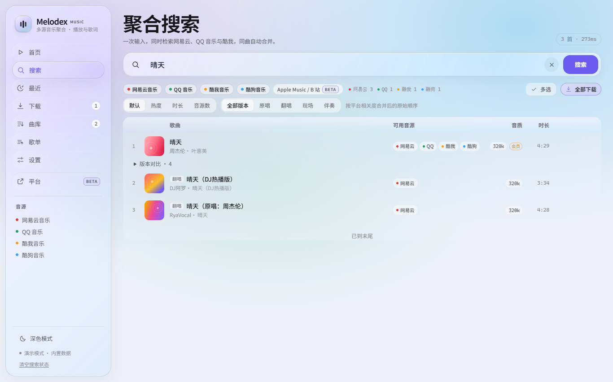
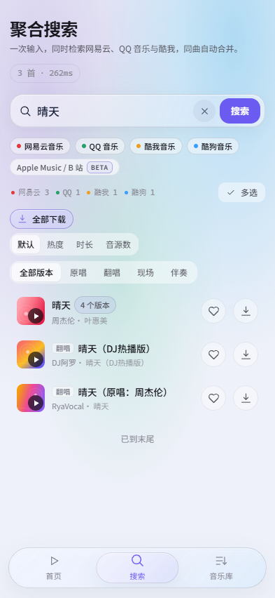
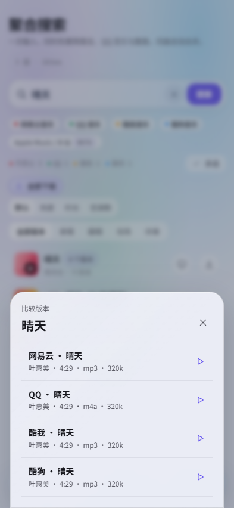

# Melodex Music

[简体中文](README.md) · [Downloads](https://github.com/LunaShiori/Melodex-Music/releases/latest) · [Changelog](CHANGELOG.md) · [Issues](https://github.com/LunaShiori/Melodex-Music/issues)

Search NetEase Cloud Music, QQ Music, Kuwo and Kugou together. Compare recordings, preview a source, and keep the tracks you want in a queue or playlist. The 3.0 Full release includes glass-style interfaces for desktop and mobile.



| Task | How it works |
| --- | --- |
| Compare recordings | Search by title or artist. Compare sources, albums, durations and available quality. On mobile, tap the version count to audition a result. |
| Resume listening | Restore your online queue and position from Home, follow synced lyrics, or save the queue as a playlist. |
| Move your collection | Filter favorites, export favorites and local playlists, then preview and merge the backup on another device. |
| Download a batch | Select tracks, review the requested quality and duplicates, then track the batch and retry failed items in Downloads. |
| Explore other catalogs | Enable **BETA** to search Apple Music and Bilibili. Save discoveries, match them against the main sources, and confirm the recordings before creating a playlist. |

Apple Music offers previews where available. Bilibili results open the original video. Playback, downloads and delivered quality depend on the source and account permissions. When a grouped result has another available source, the player can try it automatically.

<p align="center">　</p>

Screenshots show the local 3.0 Full demo with the Chinese interface.

## Install and develop

Choose an asset from the [latest release](https://github.com/LunaShiori/Melodex-Music/releases/latest): Windows installer or MSI, macOS DMG, Linux AppImage or DEB, or Android APK. You can check for updates in Settings.

For a browser preview with demo data, install Node.js and run the following from the repository root:

```sh
npm ci
npm run dev
```

The native application uses Tauri and Rust. Vue, Pinia, Vue Router and Vite power the interface. See the [contributing guide](CONTRIBUTING.md) for development setup.

## Open source

Melodex uses the [Apache-2.0 license](LICENSE). See [NOTICE](NOTICE) for attribution, the [component inventory](THIRD_PARTY_LICENSES.txt) for direct dependencies, and the [SIL OFL license](public/licenses/NotoSansSC-OFL.txt) for the bundled Noto Sans SC font.
