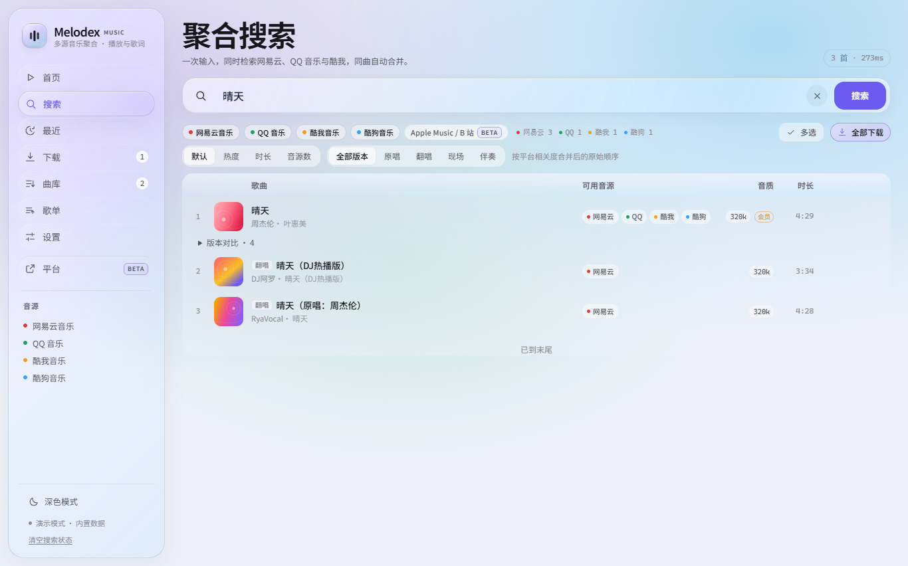
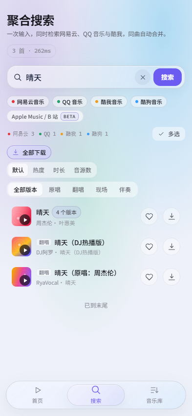
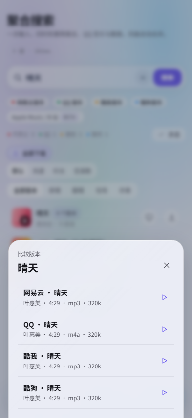

# Melodex Music

[English](README.en.md) · [下载安装包](https://github.com/LunaShiori/Melodex-Music/releases/latest) · [更新记录](CHANGELOG.md) · [反馈问题](https://github.com/LunaShiori/Melodex-Music/issues)

一个搜索框，查找网易云音乐、QQ 音乐、酷我音乐和酷狗音乐中的歌曲。比较同一首歌的不同版本，试听、加入队列，或把选好的歌曲保存成歌单。3.0 Full 为桌面和手机分别设计了液态玻璃界面。



## 从找歌到整理音乐

| 想做什么 | 在哪里操作 |
| --- | --- |
| 找到合适的录音 | 在「搜索」输入歌名或歌手，展开版本比较来源、专辑、时长和已知音质。手机版点歌曲旁的版本数即可试听。 |
| 接着上次听 | 首页恢复上次的在线队列和进度，播放页可看逐行歌词，队列也可以另存为歌单。 |
| 整理和迁移歌单 | 在「我的收藏」按歌手或关键词筛选；导出收藏和本地歌单，在另一台设备预览后合并。 |
| 下载一批歌曲 | 多选或下载整批，提交前核对重复项和请求音质。在下载中心按批次查看进度、重试失败项。 |
| 收藏其他平台的发现 | 开启带框的 **BETA** 选项搜索 Apple Music 和 B 站。在发现夹勾选条目，匹配主音源的候选版本，确认后生成歌单。 |

Apple Music 在平台提供片段时可试听；B 站视频可打开原页面。主音源的播放、下载与实际音质取决于平台返回的版本和账号权限。同一结果有其他可用来源时，播放器会尝试切换。

<p align="center">　</p>

截图取自 3.0 Full 本地演示模式，展示桌面与手机布局。

## 安装与开发

从[最新发行版](https://github.com/LunaShiori/Melodex-Music/releases/latest)选择系统对应的附件：Windows 使用安装程序或 MSI，macOS 使用 DMG，Linux 使用 AppImage 或 DEB，Android 使用 APK。应用内可在设置中检查更新。

浏览器预览使用演示数据。安装 Node.js 后，在仓库根目录运行：

```sh
npm ci
npm run dev
```

原生端使用 Tauri 与 Rust，前端使用 Vue、Pinia、Vue Router 和 Vite。参与开发见[贡献指南](CONTRIBUTING.md)。

## 开源与致谢

项目代码采用 [Apache-2.0](LICENSE)。工程参考与作者署名见 [NOTICE](NOTICE)，直接依赖及各自许可集中在[第三方组件清单](THIRD_PARTY_LICENSES.txt)。随包字体 Noto Sans SC 使用 [SIL OFL 1.1](public/licenses/NotoSansSC-OFL.txt)。
