# Melodex

**多源音乐聚合搜索与下载 · Windows 桌面端 + Android 手机端**

一次输入，同时检索网易云音乐、QQ 音乐、酷我音乐，把同一首歌的三份结果合并成一条，
统一试听、批量下载、自动写标签。桌面端用 Rust 引擎跑本地下载，手机端共用同一套核心与界面。

<sub>关键词：多源音乐聚合搜索 · 音乐下载器 · 网易云音乐下载 · QQ音乐下载 · 酷我音乐 · 批量下载 · 断点续传 · 320kbps 与无损 · ID3 标签 · 歌词内嵌 · 在线更新 · Tauri 应用 · Windows 桌面端 · Android 应用 · `music downloader` · `music aggregator`</sub>

<!-- 徽章：仓库地址替换成你自己的即可 -->
[](LICENSE)
[](#平台支持)
[](crates/melodex-core)
[](src)

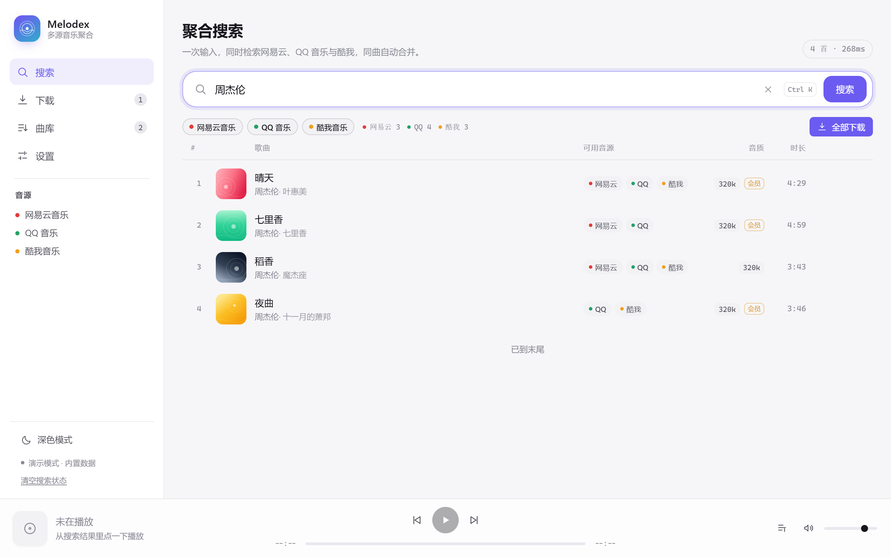

---

## 目录

- [它解决什么问题](#它解决什么问题)
- [功能](#功能)
- [界面](#界面)
- [账号与本地加密](#账号与本地加密)
- [在线更新](#在线更新)
- [架构](#架构)
- [关键实现](#关键实现)
- [音源接入现状](#音源接入现状)
- [平台支持](#平台支持)
- [快速开始](#快速开始)
- [构建 Windows 安装包](#构建-windows-安装包)
- [构建 Android APK](#构建-android-apk)
- [发布安装包（GitHub Release）](#发布安装包github-release)
- [开发与调试](#开发与调试)
- [项目结构](#项目结构)
- [常见问题](#常见问题)
- [已知限制与路线图](#已知限制与路线图)
- [免责声明](#免责声明)
- [许可证](#许可证)
- [English](#english)

---

## 它解决什么问题

想下一首老歌，你得挨个平台试：这家没有版权、那家只有 128k、第三家给了链接却是试听片段。
**Melodex 把这个过程收敛成一次操作**：

| 传统做法 | Melodex |
| --- | --- |
| 逐个 App 搜索、比对是不是同一首 | 一次并发检索三家，同一首歌自动合并为一行 |
| 这家的链接失效了，复制歌名去下一家再搜 | 行内的来源标签直接切换，一首歌三条取流通道 |
| 下到一半断了，从头再来 | HTTP Range 断点续传，`.part` 临时文件 |
| 想要 320k 结果给了 128k，得自己降级重试 | 音质降级链自动尝试，逐级回退并在界面标注实际音质 |
| 文件名叫 `晴天 - 周杰伦.mp3` 却不带标签和封面 | 按模板命名，写入 ID3v2.3 标签、内嵌封面、保存歌词 |

产品定位是**自用的聚合客户端**，不是曲库服务：不托管内容、不做破解，只做「一次输入、多源比对、
择优取流、规范落盘」这一段。

## 功能

**搜索**

- 三源并发检索（可单独开关音源），单源 9 秒超时，慢的源不会拖垮整次搜索
- 跨源同曲合并：标题归一化 + 首位歌手 + 时长分桶（3 秒粒度）生成指纹
- 相关性重排：完全匹配 > 前缀匹配 > 包含匹配，热门度与音质参与加权
- 逐源结果报告：`网易云 3 · QQ 4 · 酷我 3`，某个源超时/失败单独标红，不影响其它源
- 分页加载、结果骨架屏、空态热词、`Ctrl/⌘ + K` 聚焦搜索框

**试听**

- 底部常驻播放器：封面、进度拖拽、音量、上一首/下一首、播放队列
- 歌词抽屉：随播放高亮当前行，支持双语歌词（原文 + 翻译）
- 行内封面悬浮播放、双击整行播放、列表内联均衡器动画

**下载**

- 队列 + 并发泵调度，并发数 1–8 实时可调（默认 3），改动立即生效
- 状态机：排队 → 解析 → 下载 → 写标签 → 完成，可暂停/继续/取消/重试
- 断点续传：Range 续传 + 416 兜底 + `.part` 原子改名，异常退出后可恢复
- 音质降级链：目标音质取不到时按 `320 → 192 → 128` 逐级尝试
- 实时进度与速度、单条错误原因、批量「全部下载」、一键清理已结束
- 退出后任务列表持久化（桌面端 `tasks.json`），重启仍在

**文件与标签**

- 命名模板：`{title} {artist} {album} {source} {bitrate} {index:02}`，非法字符自动清洗、保留名规避
- 重名策略：保留两份 / 覆盖 / 跳过
- ID3v2.3 标签写入（TIT2/TPE1/TALB/TXXX/USLT+APIC），UTF-16LE 编码，兼容中文与老旧播放器
- 可选内嵌封面、可选保存 `.lrc` 歌词

**界面**

- 深/浅双主题，CSS 变量设计系统，无 UI 框架依赖
- 桌面端侧栏导航，≤860px 自动切为底部标签栏；触屏设备显示常驻播放徽标
- 程序化生成封面（无图时按曲目指纹生成渐变唱片），不请求第三方图床

**账号与登录**

- 实测（未登录，周杰伦 10~12 首样本）：网易云 **3/12** 可播、QQ 音乐 **0/10**、酷我 **10/10**
  —— 不登录时大部分歌拿不到直链，所以登录不是可选项
- 网易云：官方二维码扫码（手机 App「扫一扫」→ 确认），全程不接触账号密码
- QQ 音乐：QQ 互联二维码扫码，用手机 QQ「扫一扫」；也支持从浏览器 F12 复制 `Cookie` 整行导入
- 酷我：免登录可用，界面直接标注
- **凭据本地加密**：AES-256-GCM 落盘，主密钥随机生成；可再设 PIN（Argon2id 派生 KEK 包裹主密钥），
  没 PIN 就解不开。界面只拿到「登录了哪个账号 / Cookie 含哪些键」，永远读不到明文

**在线更新**

- 启动时静默检查一次 GitHub Releases，有新版本才在左下角浮出提示，失败不打扰
- 「设置 → 关于 → 检查更新」可手动检查，展示版本号、更新说明与安装包列表
- 更新弹窗按平台把合适的安装包排在最前（Windows `.exe` / Android `.apk`），点击交给系统浏览器下载
- 也支持自建清单（`{"version","notes","url","assets"}`），用 `MELODEX_UPDATE_FEED` 环境变量即可换源

## 界面

| 桌面端 | |
| --- | --- |
|  | 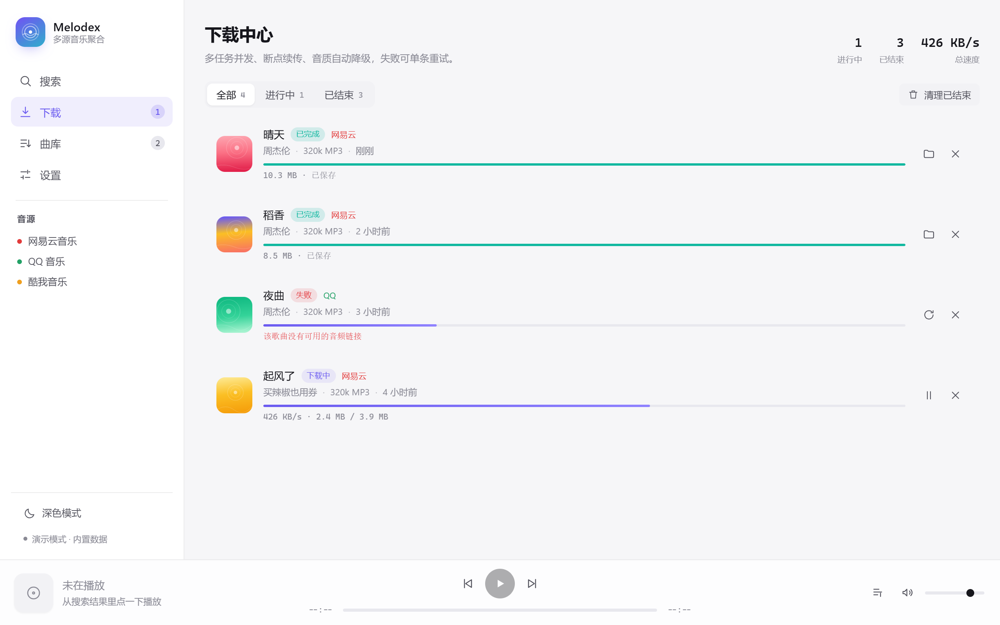 |
| 聚合搜索：一行一首，右侧是可用音源 | 下载中心：进度、速度、失败原因 |
| 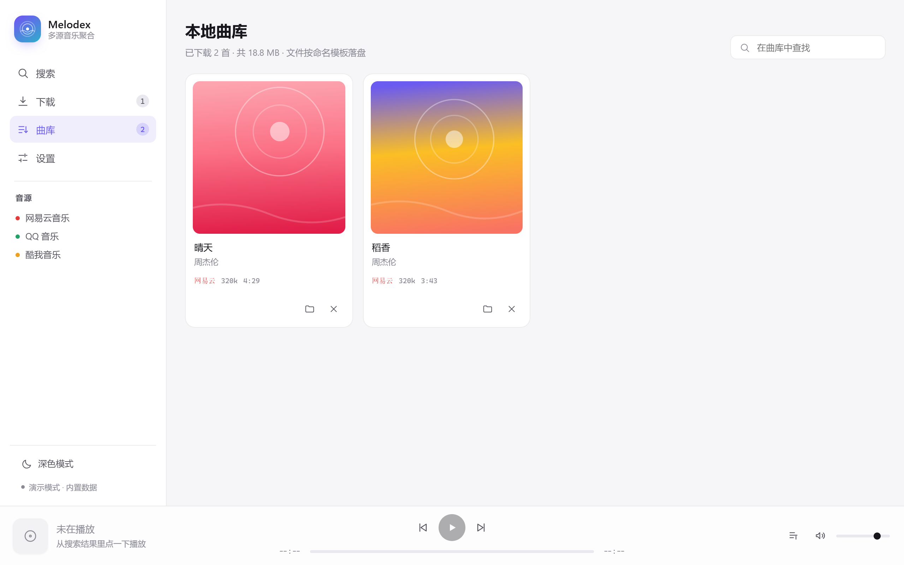 | 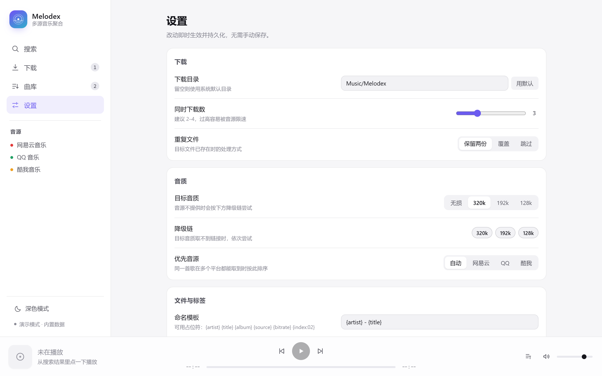 |
| 本地曲库：已下载文件按封面网格陈列 | 设置：目录、并发、音质、命名实时预览 |
| 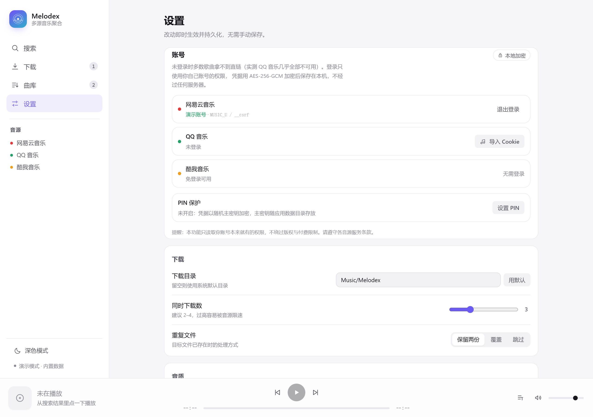 | 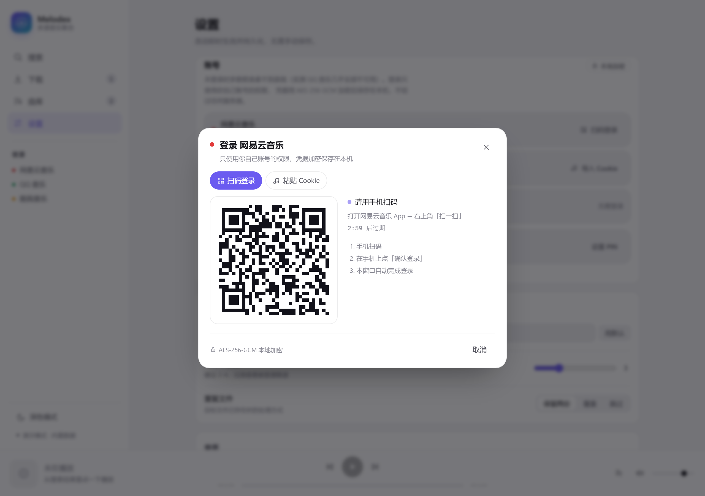 |
| 设置 → 账号：三源登录状态与保存的 Cookie 键 | 网易云扫码登录：二维码 + 实时状态 |
| 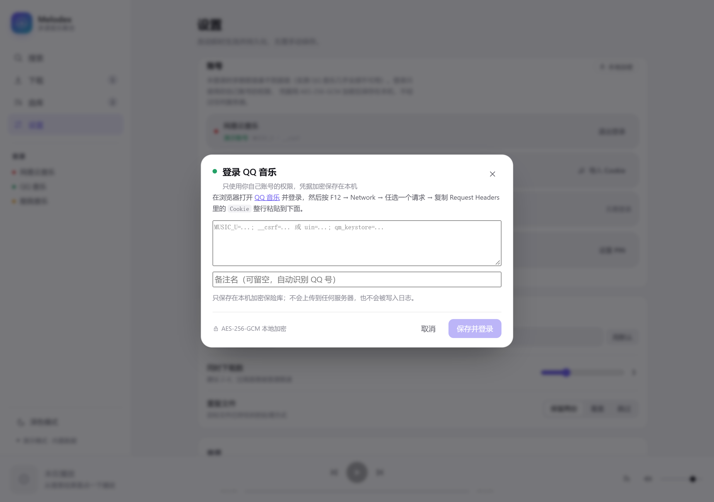 | 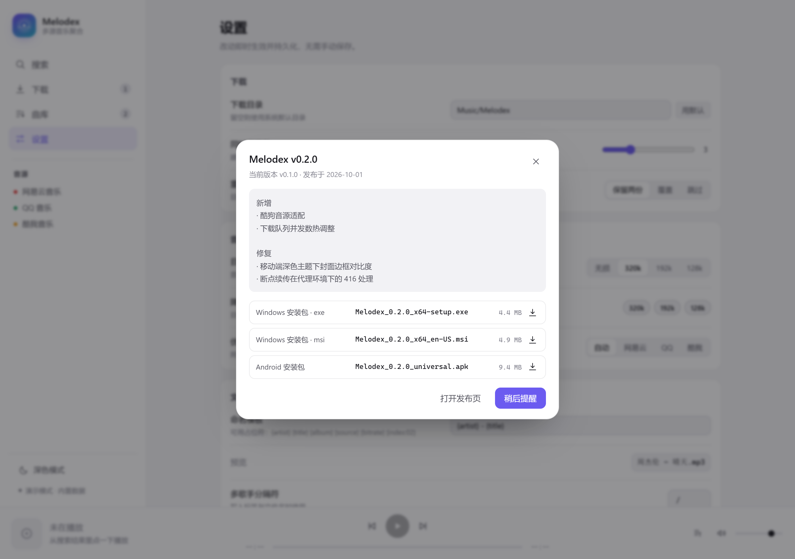 |
| QQ 音乐：粘贴 Cookie 导入（附取法说明） | 更新弹窗：版本说明 + 按平台排序的安装包 |

| Android | | | |
| --- | --- | --- | --- |
| 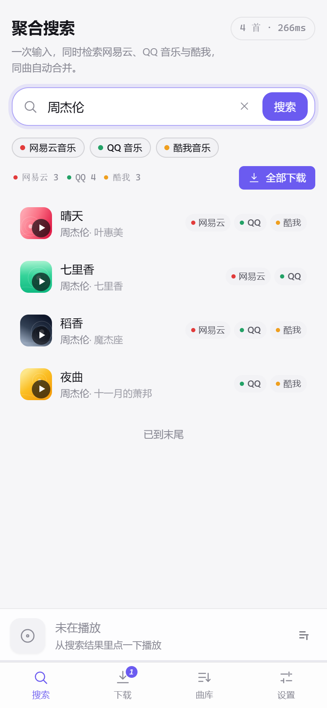 | 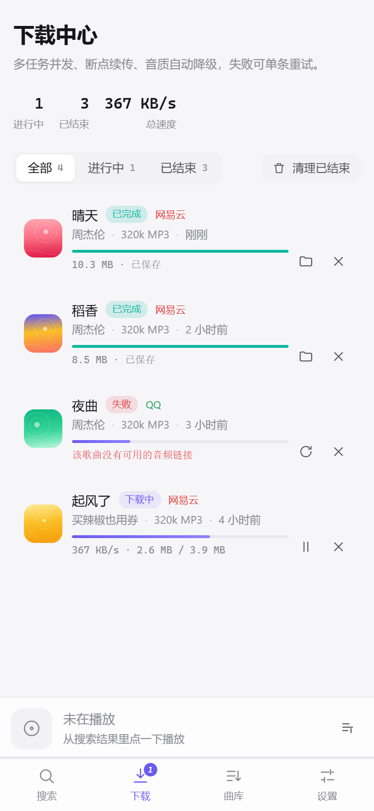 | 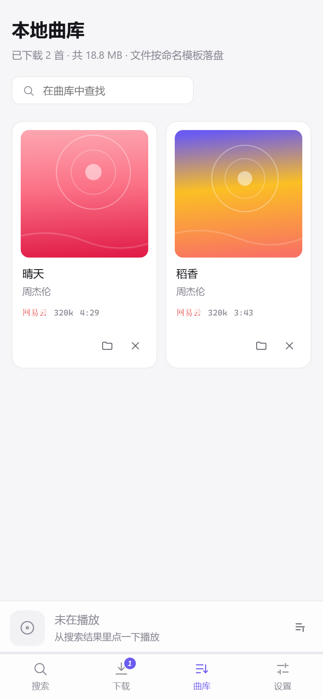 | 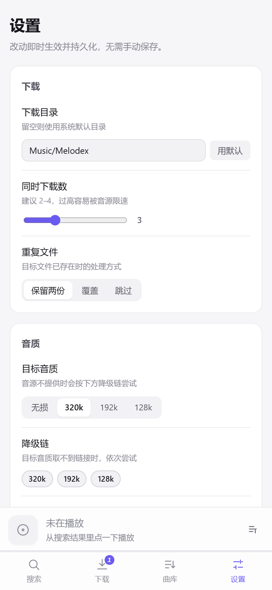 |
| 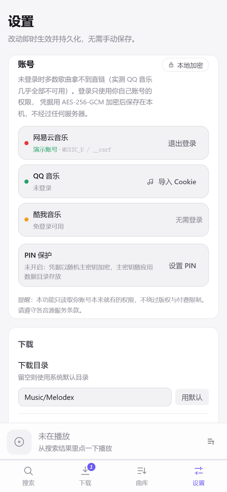 | | | |
| 移动端账号：同一套登录与加密逻辑 | | | |

## 账号与本地加密

### 为什么需要登录

未登录能搜到歌，但拿不到直链 —— 各音源对「匿名请求」的限制不同，实测差距很大：

| 音源 | 未登录可播（周杰伦样本） | 限制表现 |
| --- | --- | --- |
| 网易云音乐 | 3/12 | 会员曲返回 `url: null, code: 404`，不是降音质，是整首不可用 |
| QQ 音乐 | 0/10 | 匿名请求直接被拒：`req_0.code = 104009`，`msg` 为 `1.2.3.4;invalidq;` |
| 酷我音乐 | 10/10 | 免登录直出，但实际是 **128 kbps mp3**（见下文「音质的真相」） |

登录后用的是**你自己账号本来就有的权限**：不共享账号、不绕过付费墙、不破解签名。

### 三种接入方式

| 音源 | 方式 | 说明 |
| --- | --- | --- |
| 网易云音乐 | 二维码扫码 | 官方 `login/qrcode` 接口，返回 URL，本地渲染成 SVG |
| QQ 音乐 | 二维码扫码 | QQ 互联 `ptqrshow` 返回 PNG 位图，直接以 `data:` URI 展示；也可粘贴 Cookie |
| 酷我音乐 | 无需登录 | 界面直接标注「免登录可用」 |

扫码状态机：`等待扫码 → 已扫描待确认 → 登录成功`，二维码 2~3 分钟过期，过期可一键重取。

QQ 音乐的扫码比网易云多两跳：`ptuiCB` 返回成功后，要先跟随 `check_sig`
拿到 `uin` / `skey`，再用 `skey` 换 `qm_keyst` 才算真正登录 QQ 音乐。
中间那一跳必须**禁止自动重定向**，否则 `Set-Cookie` 会丢在跳转过程中。

### 为什么某首歌下不了

失败不再是一句笼统的「该歌曲没有可用的音频链接」。应用会告诉你是哪一种：

| 界面提示 | 含义 | 你能做什么 |
| --- | --- | --- |
| 需要登录 | 该音源要求登录态才下发链接 | 点「去登录」 |
| 会员专享 | 该音源把这首划为会员内容 | 登录，或让引擎换源 |
| 无此音质 | 该音源没有你要的档位（已自动降级） | 改低一档音质 |
| 已下架 | 版权方下架或当前地区不可播 | 换音源 |
| 网络异常 | 网络或音源服务抖动 | 重试 |

判定用的是各音源自己的字段，不是猜的：

- **QQ 音乐**：`req_0.code = 104009` → 需登录；`midurlinfo[0].result = 101404`
  → 该档位没有文件，继续降级；`pneedbuy` / `tips` 非空 → 会员专享。
- **网易云**：未登录时 `privilege.dlLevel` 恒为 `none`、`st` 常为 `-200`，
  两个信号都不可信，因此一律先报「需要登录」；登录后才用 `st` 与 `fee` 区分下架与会员。
- **酷我**：`antiserver` 不放行时返回纯文本，按内容归类。

### 自动换源

一首歌在 QQ 音乐要会员、在酷我免费是常态。入队时会把同一首歌在其它音源上的 ID
一起带上，首选源所有档位都拿不到链接时，引擎自动换下一个源，成功后任务上标
「自动换源」。**这不是绕过付费墙**——每个音源取的都是它自己免费开放的那一档。

### 音质的真相

不同音源能给你的最高音质差别很大，且常常和搜索结果标的数字不一致：

| 音源 | 未登录实测 | 说明 |
| --- | --- | --- |
| 酷我音乐 | 128 kbps mp3 | 搜索结果标 `MP3H`（320k），但 `convert_url` 传 `320kmp3` 或 `flac` 都返回同一个 128k 文件 |
| QQ 音乐 | 必须登录 | 登录后按账号权益给 128k / 320k / FLAC |
| 网易云音乐 | 基本不可用 | 登录后按账号权益给档位 |

所以应用里的音质是**如实上报**的：拿不到 FLAC 就显示 128k，不会把 128k
标成 320k 让下载记录好看。

### 凭据怎么存

```
<应用数据目录>/vault/
├── master.key   # 32 字节随机主密钥；或 "MPIN" + salt + AES-GCM(主密钥)
└── vault.bin    # "MELODEX-VAULT1" + nonce + AES-256-GCM(JSON)
```

- **默认**：随机主密钥加密，主密钥单独一个文件，Unix 上权限 `0600`；
- **可选 PIN**：主密钥用 `Argon2id(PIN, salt)` 派生的 KEK 包裹，没 PIN 解不开；
- 每条凭据只存 `cookie / nickname / saved_at`，不落任何明文到磁盘（有单测断言文件字节里搜不到 Cookie 值）；
- 密文被改动一个字节就会解密失败（GCM 认证标签），不会返回半截数据；
- 前端拿到的是 `AccountInfo`（昵称 + Cookie **键名**），接口层从不回传 Cookie 值；
- 退出登录会同时删掉内存与保险库里的那条记录。

威胁模型写在 `crates/melodex-core/src/vault.rs` 顶部：防的是「应用数据目录被同步盘/备份拷走后
被直接读出」，不防「已取得本机管理员权限的攻击者」—— 需要更强隔离时，应把主密钥托管到
Windows DPAPI / Android Keystore。

## 在线更新

更新检查是**只读**的：拉清单 → 比版本号 → 提示，不自动下载、不静默覆盖文件。用户点了安装包才开始下载，
行为完全可预期，也不需要在仓库里塞签名私钥。

```
GET https://api.github.com/repos/<owner>/<repo>/releases/latest
        │
        ▼
crates/melodex-core/src/update.rs
  parse_release()      兼容 GitHub Releases 与自建极简清单
  compare_versions()   "v0.2.0" / "0.2.0-beta.1" 语义化比较
        │
        ▼
UpdateInfo { current, latest, available, notes, pageUrl, assets[] }
        │
        ▼
stores/update.ts ──► UpdateNotice.vue（左下角提示条 + 更新弹窗）
```

| 想改的东西 | 改哪里 |
| --- | --- |
| 默认发布源 | `crates/melodex-core/src/update.rs` 的 `DEFAULT_FEED` |
| 临时换源 / 内网镜像 | 环境变量 `MELODEX_UPDATE_FEED` |
| 版本号 | `package.json`、`src-tauri/tauri.conf.json`、`Cargo.toml` 三处保持一致 |
| 换成静默自动更新 | 接 `tauri-plugin-updater` + 在 CI 里注入签名密钥；现有 `check_update` 可继续复用 |

> Fork 到自己的账号后，记得把 `LunaShiori/melodex` 换成你的仓库地址（`Cargo.toml` 的 `repository`、`update.rs` 的 `DEFAULT_FEED`、`demo.ts` 里的演示链接），
> 否则「检查更新」会去查原作者的发布页。

<p align="center">
  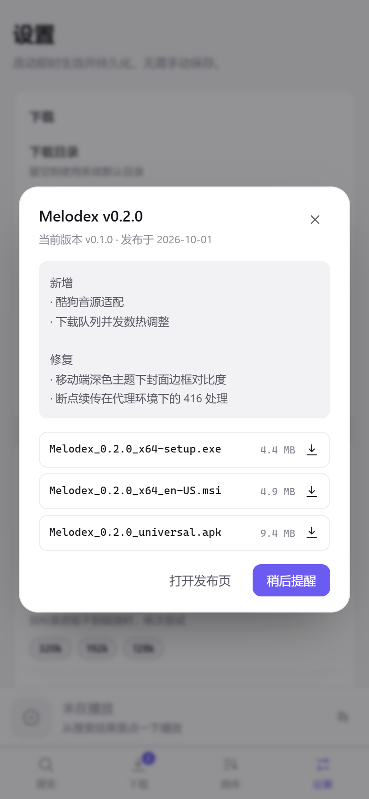
</p>

## 架构

设计参照 [HotDownloader](https://github.com/lerdb/HotDownloader) 的工程分层：**一个共享核心 + 一层很薄的平台外壳**。
核心不含任何 UI 与平台代码，因此可以脱离 Tauri 单独编译、单独测试、单独当 CLI 用。

```
┌─────────────────────────── 平台外壳（薄） ───────────────────────────┐
│  src-tauri/  Tauri 2 commands + 事件转发 + 窗口/文件系统/移动端适配   │
│  src/        Vue 3 界面，通过 Transport 抽象访问能力                  │
└───────────────────────────────┬──────────────────────────────────────┘
                                │  invoke / event  ⟷  Transport
┌───────────────────────────────▼──────────────────────────────────────┐
│  crates/melodex-core（纯 Rust，无 UI 依赖）                          │
│                                                                       │
│  aggregator   并发扇出 · 超时隔离 · 合并 · 重排 · 逐源报告            │
│  platform     MusicPlatform trait + Registry + CredStore              │
│  platforms/   netease.rs · qq.rs · kuwo.rs                            │
│  download/    engine（队列·状态机·持久化） transfer（Range 续传）      │
│               naming（模板渲染） tags（ID3v2.3 写入）                 │
│  lyric        LRC 解析 · 多时间戳 · 翻译合并 · 当前行定位              │
│  settings     配置模型 · 脱敏 · 默认目录 · 降级链                     │
│  task         任务模型与状态迁移                                       │
│  net          reqwest 客户端（超时 / UA / rustls）                    │
└───────────────────────────────────────────────────────────────────────┘
```

**一次搜索的数据流**

```
用户输入 ──► aggregator.search(keyword, page, sources)
                 │  for each source: tokio::time::timeout(9s, platform.search())
                 ▼
           [SourcePage…]  ──► interleave()    按来源轮转交错，避免单一源霸屏
                 │        ──► group_tracks()  指纹相同 → 合并为 Track（variants 累加）
                 │        ──► relevance()     相关性打分 + 音质/热门度加权排序
                 ▼
           AggregatedPage { tracks, reports, elapsed_ms }
                 │
                 ▼
           Vue Store ──► TrackRow（每行右侧列出可用音源）
```

**一次下载的数据流**

```
enqueue(Track) ──► 队列（按 concurrency 泵出）
   ▼
resolve(source, id, bitrate) ──► 拿不到就沿 bitrate_chain 降级
   ▼
naming.render(模板) ──► 沙箱化文件名 ──► resolve_target(重名策略)
   ▼
transfer(Range 续传) ──► 每 240ms 上报进度 ──► 原子改名
   ▼
spawn_blocking(write_mp3_tags) ──► 可选内嵌封面 / 保存 LRC
   ▼
Completed ──► 事件 taskUpsert 推给界面（broadcast channel + 节流）
```

### 模块划分

| 模块 | 位置 | 职责 | 关键决策 |
| --- | --- | --- | --- |
| 聚合层 | `aggregator.rs` | 并发、超时、合并、排序 | 单源超时 9s，失败降级为 `SourceReport` 而不是整次报错 |
| 音源适配 | `platform*.rs`, `platforms/*` | 统一 `search/resolve/lyric/playlist` 四件事 | 一个 trait 四个方法，新音源只加一个文件 |
| 下载引擎 | `download/engine.rs` | 队列、并发、状态机、持久化 | 队列与泵分离，并发数改动即时生效 |
| 传输 | `download/transfer.rs` | Range 续传、取消/暂停、进度回调 | 每收一块检查标志位，暂停不丢已下载字节 |
| 标签 | `download/tags.rs` | ID3v2.3 手写 | 不引入 id3 crate，避免额外依赖与体积 |
| 命名 | `download/naming.rs` | 模板渲染 + 清洗 | 与前端预览共用同一套规则 |
| 歌词 | `lyric.rs` | LRC 解析/合并/定位 | 多时间戳行展开，翻译按时间轴对齐 |
| 配置 | `settings.rs` | 模型 + 归一化 | `sanitized()` 收敛非法值（并发 1–8 等） |
| 外壳 | `src-tauri/src/lib.rs` | command + 事件 | 不做业务判断，只做转换与错误字符串化 |
| 界面 | `src/` | 视图、状态、播放器 | `Transport` 接口让浏览器里也能跑（演示模式） |

## 关键实现

**1. 跨源合并怎么判「同一首歌」**

平台给的 id 互不相通，只能靠元数据。`fingerprint = 归一化标题 | 首位歌手 | bucket(时长)`：

```rust
// crates/melodex-core/src/model.rs
pub fn normalize_title(title: &str) -> String   // 去括号后缀、去标点（含《》「」）、小写、折叠空白
pub fn fingerprint(title, artist, duration_ms) -> String {
    format!("{}|{}|{}", normalize_title(title), artist, (duration_ms + 1_500) / 3_000)
}
```

时长按 3 秒分桶（四舍五入），既能吸收各平台 1–2 秒的时长差，又不会把 3:46 和 3:52 误判成同一首；
合并时再用「时长差 ≤ 4s 且歌手集合有交集」做二次校验（`same_song`）。

**2. 音源适配只做四件事**

```rust
#[async_trait]
pub trait MusicPlatform: Send + Sync {
    fn source(&self) -> Source;
    async fn search(&self, q: &SearchQuery) -> Result<Vec<Variant>>;
    async fn resolve(&self, v: &Variant, bitrate: u32) -> Result<PlayUrl>;
    async fn lyric(&self, id: &str) -> Result<Option<Lyric>>;
    async fn playlist(&self, id: &str) -> Result<Option<PlaylistDetail>>;
    fn bitrates(&self) -> &'static [u32];
}
```

加一家音源 = 实现这个 trait + 在 `Registry::new` 里注册一行，聚合层与界面完全不用改。

**3. 下载是可恢复的状态机**

`Queued → Resolving → Downloading → Tagging → Completed`，外加 `Paused / Canceled / Failed` 三个旁路。
传输层用 `Range: bytes={downloaded}-` 续传，收到 416 就清空 `.part` 重新开始；暂停与取消靠 `AtomicBool`，
在每个 chunk 之间检查，因此暂停时已落盘的字节全部有效。

**4. 标签与命名**

不依赖第三方 id3 库，直接按 ID3v2.3 规范拼帧：`TIT2/TPE1/TALB` 文本帧、`TXXX` 自定义帧、`USLT` 歌词帧、
`APIC` 封面帧，文本用 UTF-16LE + BOM（兼容中文且不会踩 GBK 乱码）。写入时先写 `<file>.melodex-tag`
再原子改名，避免写一半留下损坏的文件。

## 音源接入现状

| 音源 | 搜索 | 取流 | 歌词 | 歌单 | 备注 |
| --- | --- | --- | --- | --- | --- |
| 网易云音乐 | ✅ | ✅ | ✅ | ✅ | 公开 web 接口，取流带 `br` 参数 |
| QQ 音乐 | ✅ | ✅ | ✅ | — | `musicu.fcg` 取 vkey，逐档尝试 flac/mp3 文件名 |
| 酷我音乐 | ✅ | ✅ | ✅ | — | 搜索返回单引号 JSON，内置宽松解析器 |
| 酷狗音乐 | ❌ | ❌ | ❌ | — | 接口要求签名（`err_code 30020`），未实现 |

设计上的取舍：**不内置任何账号、cookie 或逐流破解**。需要登录态的音源由使用者在自己的环境里提供凭据
（`CredStore` 已预留按音源注入 cookie 的位置），代码层面只处理公开接口。

## 平台支持

| 平台 | 状态 | 说明 |
| --- | --- | --- |
| Windows 10/11 x64 | ✅ 主要目标 | NSIS 安装包 + MSI，WebView2 随系统 |
| Android 8.0+ (arm64) | ✅ 同一套代码 | `tauri android build` 出 APK，界面自动切移动布局 |
| macOS / Linux | 🟡 理论可用 | 核心与界面与平台无关，未做打包验证 |

移动端的差异处理：

- **默认下载目录**落到应用专属目录（`app_data_dir()/Music`），不需要任何存储权限，也不受 Android 10+ 分区存储限制；
  用户可在设置页改成任意可写路径。
- **「打开文件夹」**在移动端没有对应语义，command 返回明确错误，界面降级为提示，引导去「本地曲库」播放。
- **播放本地文件**走 Tauri asset 协议，移动端与桌面端同一套 `convertFileSrc`。

## 快速开始

```bash
# 0) 依赖：Node 18+、Rust 1.77+（Windows 还需 VS Build Tools 的 C++ 组件）
git clone https://github.com/LunaShiori/melodex.git
cd melodex

# 1) 装前端依赖
npm install

# 2) 开发模式（自动拉起 Vite + Tauri 窗口）
npm run tauri dev
```

只想在浏览器里看界面？`npm run dev` 会进入**演示模式**：内置 12 首假数据与模拟下载任务，
不需要 Rust、不联网，也能完整体验搜索、下载、曲库、设置四条链路。

```bash
npm run dev        # http://localhost:5183
```

## 构建 Windows 安装包

```powershell
# 前置：Visual Studio Build Tools（勾选「使用 C++ 的桌面开发」）、Rust MSVC 工具链
rustup default stable-x86_64-pc-windows-msvc

npm install
npm run tauri build
```

产物：

| 文件 | 路径 |
| --- | --- |
| NSIS 安装包 | `src-tauri/target/release/bundle/nsis/Melodex_<version>_x64-setup.exe` |
| MSI 安装包 | `src-tauri/target/release/bundle/msi/Melodex_<version>_x64_en-US.msi` |
| 免安装可执行 | `src-tauri/target/release/melodex.exe` |

## 构建 Android APK

前置（缺一不可）：

```bash
# 1) JDK 17
# 2) Android SDK：platform-tools、platforms;android-34、build-tools;34.0.0
# 3) Android NDK 26.x，并设好环境变量
export ANDROID_HOME=$HOME/Android/Sdk
export NDK_HOME=$ANDROID_HOME/ndk/26.1.10909125
export JAVA_HOME=/path/to/jdk-17

# 4) Rust 交叉编译目标
rustup target add aarch64-linux-android armv7-linux-androideabi i686-linux-android x86_64-linux-android
```

```bash
npm install

# 首次：生成 Android 工程（会在 src-tauri/gen/android 落地 Gradle 项目）
npm run tauri android init

# 真机/模拟器调试
npm run tauri android dev

# 出包
npm run tauri android build -- --apk        # 通用 APK
npm run tauri android build -- --aab        # 上架用 AAB
```

产物位于 `src-tauri/gen/android/app/build/outputs/apk/universal/release/`。

**签名（必做，否则 APK 装不上）**：`tauri android init` 生成的 `app/build.gradle.kts` 里没有 `signingConfigs`，
Gradle 只会输出 `app-universal-release-unsigned.apk`。用仓库脚本补上，二选一：

```bash
# 方式 A：用仓库内置的公开 CI 密钥（口令 melodex-ci，仅用于侧载分发）
cp src-tauri/ci-signing/melodex-ci.p12 /tmp/melodex.p12
cat > src-tauri/gen/android/keystore.properties <<EOF
storeFile=/tmp/melodex.p12
storeType=PKCS12
keyAlias=melodex
password=melodex-ci
EOF

# 方式 B：用自己的密钥（上架应用商店必须这样）
keytool -genkeypair -v -keystore ~/upload.jks -storetype JKS \
  -keyalg RSA -keysize 2048 -validity 10000 -alias upload
cat > src-tauri/gen/android/keystore.properties <<EOF
storeFile=$HOME/upload.jks
storeType=JKS
keyAlias=upload
password=你的口令
EOF

# 无论哪种，都要执行一次补丁脚本（幂等，可重复跑）
python3 scripts/android-signing.py
npm run tauri android build -- --apk

# 校验产出确实已签名
python3 scripts/check-apk.py src-tauri/gen/android/app/build/outputs/apk/universal/release/*.apk
```

> 说明：`src-tauri/gen/android/` 默认不纳入版本库（见 `.gitignore`），它由 `tauri android init` 按本机 SDK 生成，
> 入库容易与 SDK/NDK 版本绑死。想固定构建环境，可去掉 `.gitignore` 里对应的那一行。

## 发布安装包（GitHub Release）

仓库内置了两条流水线：

| 工作流 | 触发 | 作用 |
| --- | --- | --- |
| `.github/workflows/ci.yml` | push / PR | 核心测试、Clippy、`cargo fmt` 检查、前端类型检查与构建 |
| `.github/workflows/release.yml` | 打 `v*` tag | 在 Windows 与 Ubuntu 上分别构建安装包，自动创建 Release 并挂上文件 |

发布一个新版本，只需要：

```bash
# 1) 三处版本号改成同一个值
#    package.json / src-tauri/tauri.conf.json / Cargo.toml(workspace)
# 2) 打 tag 并推送
git tag v0.1.1
git push origin v0.1.1
```

几分钟后 Release 里会出现这些**可直接安装**的文件：

| 平台 | 文件 | 说明 |
| --- | --- | --- |
| Windows 10/11 x64 | `Melodex_<version>_x64-setup.exe` | NSIS 安装包，双击即装（含开始菜单与卸载项） |
| Windows 10/11 x64 | `Melodex_<version>_x64_en-US.msi` | MSI，适合企业分发 / 静默安装 |
| Android 8.0+ | `app-universal-release.apk` | 通用 APK，覆盖 arm64 / armv7 / x86_64 |

两点注意：

1. **安装包必须挂在 Release 资产里**（不是只放在 Actions 的 artifact 里）——应用内的「检查更新」读的是
   `releases/latest` 返回的 `assets[]`，artifact 没过期就会随 retention 消失。
2. **Android 签名**：Android 要求「同一应用必须同一签名」才能覆盖安装，所以 CI 默认使用仓库里公开的
   `src-tauri/ci-signing/melodex-ci.p12`（口令 `melodex-ci`）。它只保证历次 Release 能装、能升级，
   不代表任何安全承诺。要换成自己的密钥，在仓库 Settings → Secrets 里加三个值即可，流水线会自动优先使用：

   | Secret | 内容 |
   | --- | --- |
   | `ANDROID_KEY_BASE64` | `base64 -w0 your.jks` 的结果 |
   | `ANDROID_KEY_PASSWORD` | keystore 口令（同时用作 key 口令） |
   | `ANDROID_KEY_ALIAS` | 别名，默认 `melodex` |

   出包后流水线会用 `scripts/check-apk.py` 校验签名块，未签名直接失败，不会把装不上的包挂上 Release。

## 开发与调试

```bash
# 核心单元测试（33 个，覆盖指纹合并、LRC、命名清洗、状态迁移等纯逻辑）
cargo test -p melodex-core --no-default-features

# 核心 + 网络层类型检查
cargo check -p melodex-core --features net

# 命令行探针：真打三家接口，看合并结果、取流、歌词
cargo run --example probe -- 晴天
cargo run --example probe -- 晴天 --download   # 顺带跑一遍下载引擎

# 前端类型检查 / 生产构建
npm run typecheck
npm run build

# 重新生成第三方许可清单
python3 scripts/gen_third_party.py -o THIRD_PARTY_LICENSES.txt
```

核心的 `net` / `tls` 特性可以关掉（`--no-default-features`），这样纯逻辑部分在没有任何 C 工具链的机器上也能编译测试。

## 项目结构

```
melodex/
├── crates/melodex-core/          # 纯 Rust 核心（可独立编译/测试）
│   ├── src/
│   │   ├── aggregator.rs         # 并发扇出 · 合并 · 重排 · 逐源报告
│   │   ├── model.rs              # Track / Variant / Source / 指纹归一化
│   │   ├── platform.rs           # MusicPlatform trait · Registry · CredStore
│   │   ├── platforms/            # netease.rs · qq.rs · kuwo.rs
│   │   ├── download/             # engine · transfer · naming · tags
│   │   ├── cookie.rs             # Cookie 串解析/合并（可单测）
│   │   ├── login/                # 扫码登录（网易云 URL→SVG / QQ 位图 + 两跳换取登录态）
│   │   ├── qr.rs                 # 二维码渲染成 SVG（无前端依赖）
│   │   ├── vault.rs              # 凭据保险库（AES-256-GCM + 可选 PIN）
│   │   ├── lyric.rs              # LRC 解析与定位
│   │   ├── settings.rs           # 配置模型与归一化
│   │   ├── task.rs               # 任务与状态机
│   │   ├── update.rs             # 更新清单解析与版本比较
│   │   ├── net.rs                # HTTP 客户端
│   │   └── pseudo_json.rs        # 宽松 JSON 解析（酷我单引号）
│   └── examples/probe.rs         # 命令行探针
├── src-tauri/                    # Tauri 2 外壳
│   ├── src/lib.rs                # commands + 事件转发
│   ├── ci-signing/               # 公开的 CI 签名密钥（仅侧载分发用）
│   ├── tauri.conf.json
│   └── icons/
├── src/                          # Vue 3 + TypeScript 界面
│   ├── components/               # SideBar · TabBar · PlayerBar · TrackRow · UpdateNotice …
│   ├── views/                    # Search · Downloads · Library · Settings
│   ├── stores/                   # search · tasks · player · settings · update（Pinia）
│   ├── lib/transport/            # Transport 抽象：tauri / demo 两套实现
│   └── styles/main.css           # 设计令牌与双主题
├── scripts/                      # 图标生成 · 第三方许可清单 · Android 签名补丁与 APK 校验
├── docs/screenshots/             # README 用截图
├── .github/workflows/            # ci.yml（检查）· release.yml（出安装包）
├── THIRD_PARTY_LICENSES.txt
├── NOTICE
└── LICENSE                       # Apache-2.0
```

## 已知限制与路线图

**已知限制**

- 酷狗因签名校验未接入；QQ 音乐歌单接口未实现。
- 音源接口属于「公开但非承诺稳定」的 web 接口，平台改动可能导致某个源失效——聚合层会把失败隔离成
  `SourceReport`，界面上仍可用其它源，但需要跟进修复适配器。
- 移动端尚未接入 MediaStore / SAF，下载文件落在应用专属目录；卸载应用会一并清理。
- 高音质（无损 / Hi-Res）依赖账号权限，无权限时自动降级到可取的档位。

**路线图**

- [ ] 酷狗适配（签名算法）与 QQ 歌单
- [ ] Android SAF / MediaStore 落盘，支持「保存到系统音乐库」
- [ ] 批量导入歌单、CSV 导出
- [ ] 代理与限速
- [ ] macOS / Linux 打包

## 常见问题

**能下载哪些平台的歌？**

目前接入三家：网易云音乐、QQ 音乐、酷我音乐。酷狗因接口签名校验未接入（见「已知限制与路线图」）。

**和市面上的音乐下载器有什么不同？**

三点：① 一个关键词同时搜三个源，结果按「标题 + 歌手 + 时长」指纹合并成一条，不用挨个 App 翻；
② 每个源单独标注能否播放、码率多少，某个源挂了不影响其它源；③ 桌面端与安卓共用同一套 Rust 核心与界面。

**下载的是 320kbps 还是无损？**

按「目标音质 → 降级链」尝试：优先请求你设置的档位，该档位拿不到就自动退到下一档，
任务里记录的是实际拿到的音质，不会静默给你一个低质文件。

**下载一半关掉会怎样？**

用 HTTP `Range` 续传，未完成的部分落在同名 `.part` 临时文件里；重新打开应用后任务自动恢复，
已下载的字节不会重下。

**下载的文件在哪？**

Windows 默认在「下载/Melodex」，可在设置里改；Android 落在应用专属目录（免存储权限），
卸载应用会一并清理。

**需要登录或付费账号吗？**

不需要内置任何账号。部分高音质取决于音源侧权限，没有权限时自动降级到可取的档位。

**会不会自动更新？**

启动时静默检查 GitHub Releases，有新版本才在左下角提示；安装包由你确认后下载，不会静默替换文件。

**能打包成 macOS / Linux 版吗？**

代码本身跨平台，Tauri 也支持；目前只维护 Windows 与 Android 两条构建流水线。

**为什么要登录？不登录会怎样？**

不登录能搜到歌，但大部分歌拿不到直链：实测网易云 12 首里只有 3 首可播，QQ 音乐 10 首全军覆没。
登录用的是你自己账号本就有的权限，不会破解或绕过付费。

**保存的账号安全吗？**

Cookie 用 AES-256-GCM 加密后存在本机 `vault/` 目录，主密钥单独存放；还可以再设 PIN
（Argon2id 派生密钥包裹主密钥），没有 PIN 就打不开。界面任何位置都读不到 Cookie 明文。

**点「下载」程序就闪退了怎么办？**

v0.1.0 存在这个缺陷：入队命令是同步 command，跑在主线程上，而派发下载任务用的
`tokio::spawn` 需要运行时上下文，于是 panic → 进程 abort。v0.1.1 已修复
（命令改为异步 + 派发逻辑三级兜底）。请升级到最新版本。

如果新版仍有异常，程序会在应用数据目录写崩溃日志：

| 平台 | 路径 |
| --- | --- |
| Windows | `%APPDATA%\app.melodex\crash.log` |
| Android | 应用专属目录下的 `crash.log` |

同目录的 `tasks.json` 记录任务状态。附上 `crash.log` 提 Issue 即可定位。

## 免责声明

- 本项目仅用于**个人学习与技术研究**，用于验证多源聚合、断点续传、标签写入等工程方案。
- 本项目**不提供、不托管、不分发任何音频内容**。所有音频、歌词、封面均来自第三方平台的公开接口，
  版权归各平台与权利人所有。
- 请勿将本项目用于商业用途、批量抓取或任何侵犯著作权的行为。因使用本项目产生的一切后果由使用者自行承担。
- 请支持正版：喜欢一首歌，去对应平台开通会员。
- 本项目与网易云音乐、QQ 音乐、酷我音乐及其关联公司**没有任何关系**，未获其授权或认可；
  相关名称与商标归各自所有者。

## 许可证

[Apache License 2.0](LICENSE) © Melodex Contributors

- 架构与合规做法参照 [HotDownloader](https://github.com/lerdb/HotDownloader)（Apache-2.0）；本项目未复制其源码，
  仅在工程分层与「LICENSE + NOTICE + THIRD_PARTY_LICENSES」的合规实践上保持一致。
- 第三方组件清单见 [THIRD_PARTY_LICENSES.txt](THIRD_PARTY_LICENSES.txt)，归属声明见 [NOTICE](NOTICE)。
- 提交贡献即表示同意以 Apache-2.0 授权你的贡献，详见 [CONTRIBUTING.md](CONTRIBUTING.md)。

## English

**Melodex** is a cross-platform music *aggregator*: one query fans out to NetEase Cloud Music,
QQ Music and Kuwo, then merges the same song from different platforms into a single row with
per-source download channels. Built as a shared Rust core (`crates/melodex-core`) plus thin shells —
Tauri 2 for Windows desktop and Android, Vue 3 + TypeScript for the UI.

Highlights: cross-source merging by title/artist/duration fingerprint, per-source failure isolation,
resumable downloads with HTTP Range, automatic bitrate fallback, ID3v2.3 tagging with embedded cover
and lyrics, a single responsive UI that turns into a mobile layout below 860 px, and a read-only
online update check against GitHub Releases (no silent self-replacement).

Installable builds are produced by CI: push a `v*` tag and the release workflow attaches a Windows
NSIS installer, an MSI, and a universal Android APK to the GitHub Release.

It ships **no content** and bundles **no credentials**: it only talks to public endpoints you point it at.
For personal study and engineering research — respect copyright, support the artists.

```bash
npm install && npm run tauri dev      # desktop dev
npm run tauri build                   # Windows installers
npm run tauri android build -- --apk  # Android APK
```

Licensed under [Apache-2.0](LICENSE).
